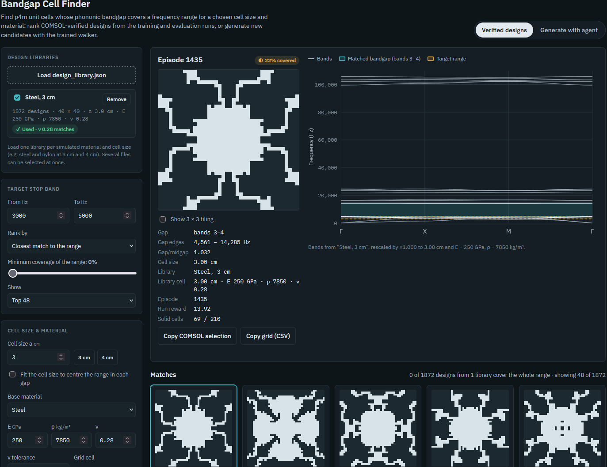

# Design of Broadband Bandgap Structures by Soft Actor–Critic Reinforcement Learning

Code, trained agents, and data for the manuscript

> S. B. Gebrekidan, F. Toth, *Design of broadband bandgap elastic structures by soft actor–critic reinforcement learning* (submitted).

A discrete soft actor–critic (SAC) agent with prioritized experience replay (PER) draws p4m-symmetric unit cells on a 40 × 40 grid by walking through one-eighth of the cell. Each design is evaluated in COMSOL Multiphysics (Floquet–Bloch eigenfrequency analysis, first 20 bands along Γ–X–M–Γ), and the cumulative bandgap between consecutive bands is maximized. The agent is trained on a 4 cm × 4 cm cell with soft nylon and evaluated, without retraining, with steel on the same cell and on a 3 cm × 3 cm cell.



## Repository structure

| Folder | Content |
|---|---|
| `src/` | Discrete SAC agent (`dsac.py`): actor, two critics, target critics, automatic entropy tuning. |
| `utils/` | Prioritized experience replay (`PER.py`), p4m mirroring and connectivity checks (`utils.py`). |
| `envs/` | Walking environment (`WalkingEnv.py`) and COMSOL environments (`DRLComEnv*.py`) for each cell size and material. |
| `comsolfile/` | COMSOL model (`.mph`) of the 4 cm × 4 cm unit cell. |
| `webapp/` | Bandgap Cell Finder web application and the data converter `export_for_app.py`. |
| `DRLvib_revised_*` | One folder per experiment (see below), each with its script, `run.sh`, log, trained checkpoint and/or history, and figures. |

### Experiments

| Folder | Experiment in the manuscript | Cell, material | COMSOL environment |
|---|---|---|---|
| `DRLvib_revised_4cm_with_PER` | Training of the reference agent (with PER) | 4 cm, soft nylon | `DRLComEnv.py` |
| `DRLvib_revised_4cm_withoutPER` | Reference training without PER (comparison) | 4 cm, soft nylon | `DRLComEnv.py` |
| `DRLvib_revised_4cm_Steel_eval` | Pre-trained agent evaluated without retraining (500 episodes) | 4 cm, steel | `DRLComEnv_Steel.py` |
| `DRLvib_revised_4cm_Steel_train` | Agent trained from scratch | 4 cm, steel | `DRLComEnv_Steel.py` |
| `DRLvib_revised_3cm_steel_40_eval` | Pre-trained agent evaluated without retraining (500 episodes) | 3 cm, steel, 40 × 40 grid | `DRLComEnv3cm_steel_40.py` |
| `DRLvib_revised_3cm_steel_trained` | Agent trained from scratch | 3 cm, steel, 40 × 40 grid | `DRLComEnv3cm_steel_40.py` |

Material parameters: soft nylon E = 0.38 GPa, ρ = 1410 kg/m³, ν = 0.35; steel E = 250 GPa, ρ = 7850 kg/m³, ν = 0.28.

## Discrete SAC agent

### Training procedure

| Step | Note |
|---|---|
| Initialize actor $\pi_{\phi}(a \mid s)$ and critics $Q_{\theta_1}$, $Q_{\theta_2}$ | |
| Initialize target critics $\bar{Q}_{\theta_1}$, $\bar{Q}_{\theta_2}$ | |
| Initialize prioritized replay buffer $\mathcal{D} \leftarrow \emptyset$ | |
| Initialize temperature $\alpha$ and target entropy $\mathcal{H}_{\mathrm{target}} = 0.98 \log \lvert A \rvert$ | |
| **For each episode:** | |
| &emsp;Reset environment, observe $s_0$ | Random start row, first column |
| &emsp;**For each of the 500 steps:** | |
| &emsp;&emsp;Sample $a_t \sim \pi_{\phi}(a_t \mid s_t)$ | Stochastic policy |
| &emsp;&emsp;Execute $a_t$, observe $(s_{t+1}, r_{int}, d_t)$ | |
| &emsp;&emsp;Store $(s_t, a_t, r_{int}, s_{t+1}, d_t)$ temporarily in $\mathcal{D}_0$ | |
| &emsp;Compute final reward $r_{final}$ | COMSOL; $-20$ if the design is disconnected |
| &emsp;Add $r_{final}$ to the last transition ($d_t = 1$) | Terminal reward |
| &emsp;Store all transitions in $\mathcal{D}$ with maximum priority | |
| &emsp;**Gradient step** (once per episode): | |
| &emsp;&emsp;Sample minibatch $(s, a, r, s', d)$ with $P(i) \propto p_i$ and weights $w_i$ | PER sampling |
| &emsp;&emsp;$y = r + \gamma (1-d) \sum_{a'} \pi_{\phi}(a' \mid s') \left(\min_i \bar{Q}_{\theta_i}(s',a') - \alpha \log \pi_{\phi}(a' \mid s')\right)$ | Target value |
| &emsp;&emsp;$\mathcal{L}_{Q_i} = w \left(Q_{\theta_i}(s,a) - y\right)^2$ | Weighted critic loss |
| &emsp;&emsp;$p = \left(\lvert \delta \rvert + \epsilon\right)^{\alpha_p}$ | Priority update |
| &emsp;&emsp;$\mathcal{L}_{\pi} = \sum_{a} \pi_{\phi}(a \mid s) \left(\alpha \log \pi_{\phi}(a \mid s) - \min_i Q_{\theta_i}(s,a)\right)$ | Actor loss |
| &emsp;&emsp;$\mathcal{L}_{\alpha} = -\log\alpha \sum_{a} \pi_{\phi}(a \mid s) \left(\log \pi_{\phi}(a \mid s) + \mathcal{H}_{\mathrm{target}}\right)$ | Entropy tuning |
| &emsp;&emsp;$\bar{\theta}_i \leftarrow \tau \theta_i + (1-\tau)\bar{\theta}_i$ | Target network update |
| **Output:** $\phi$, $\theta_1$, $\theta_2$ | Trained networks |

### Architecture and training configuration

| Component | Specification |
|---|---|
| State space (position $(r,c)$ and $20 \times 20$ occupancy grid) | 402 |
| Action space (four neighbouring grid cells) | 4 |
| Actor network | MLP (3 hidden layers, 80 neurons each) |
| Hidden activation | ReLU |
| Actor output | Softmax |
| Critic network | MLP (3 hidden layers, 80 neurons each) |
| Critic output | Linear |
| Critic networks | 2 |
| Target networks | 2 |
| Optimizer (actor, critics, temperature) | Adam |
| Learning rate | $6 \times 10^{-4}$ |
| Discount factor | 0.99 |
| Soft update rate ($\tau$) | $10^{-2}$ |
| Batch size | 128 |
| Gradient updates per episode | 1 |
| Replay buffer size | $5 \times 10^{5}$ transitions |
| PER parameters ($\alpha_p$, $\beta$, $\epsilon$) | 0.6, 0.4 → 1, $10^{-2}$ |
| Exploration | Stochastic policy, automatic tuning of $\alpha$ |
| Total episodes | 2000 (training), 500 (validation) |
| Steps per episode | 500 |
| Entropy target | $0.98 \log \lvert A \rvert$ |

## Requirements

- COMSOL Multiphysics 6.3 with a valid licence
- Python 3 with `torch`, `numpy`, `scipy`, `matplotlib`, `gym`, and [`mph`](https://github.com/MPh-py/MPh) (Python interface to COMSOL)

## Running an experiment

Each experiment folder contains a `run.sh` that sets the COMSOL path and starts the script of that folder. Adapt `COMSOL_ROOT` and the Python interpreter to your system, then run from inside the folder:

```bash
cd DRLvib_revised_4cm_with_PER
bash run.sh
```

The scripts add the repository root to the Python path (`sys.path.append("..")`), so they must be started from their own folder. Training scripts save a checkpoint every 100 episodes and the training history (`*.npy`) at the end. The evaluation scripts load the checkpoint of the reference agent from `DRLvib_revised_4cm_with_PER/`.

Each history file is a list of episode dictionaries with the visited positions (`states`), the actions, the rewards, the final reward, and the dispersion bands (`bandgap`, 32 × 20 array: one duplicate row of k = 0 followed by 31 k-points × 20 bands).

## Bandgap Cell Finder (web app)

`webapp/bandgap_cell_finder.html` is a browser application that runs entirely client-side (no server, Python, or COMSOL needed). Open it in a browser or serve it with GitHub Pages.

- **Verified designs:** ranks the COMSOL-simulated unit cells from one or more design libraries by how well their bandgaps cover a target frequency range. Library frequencies are rescaled to a chosen cell size and material, f = f₀ (a₀/a) √((E/ρ)/(E₀/ρ₀)); this is exact only between data with the same Poisson's ratio, so libraries are matched by ν.
- **Generate with agent:** runs the trained actor in a JavaScript copy of the walking environment and generates unit cells without finite element analysis. Generated designs are checked for connectivity and must be verified in COMSOL.
- **Inspector:** full p4m unit cell (optionally tiled 3 × 3), dispersion diagram with the matched bandgap and target range, and export of the geometry as a COMSOL selection list or CSV grid.

The page includes the soft-nylon 4 cm library and a trained actor. `webapp/lib_steel_3cm.json` is a steel 3 cm library that can be loaded with *Load design_library.json*.

### Preparing data

History (`.npy`) and checkpoint (`.pth`) files are Python pickles that a browser cannot read. Convert them with `webapp/export_for_app.py`:

```bash
# one library per material and cell size
python export_for_app.py --history ../DRLvib_revised_4cm_Steel_train/SAC4cm_steel_train_without_PER_history.npy --material steel --size-cm 4 --library-out lib_steel_4cm.json
python export_for_app.py --history ../DRLvib_revised_3cm_steel_trained/SAC3cm_trained_history.npy --material steel --size-cm 3 --library-out lib_steel_3cm.json

# trained actor
python export_for_app.py --checkpoint ../DRLvib_revised_4cm_with_PER/SAC_DISCRETE_PER_WO_frame_agent_checkpoint_ep2000.pth --agent-out agent.json
```

Run `python export_for_app.py -h` for all options (`--material nylon|steel`, `--E0`, `--rho0`, `--nu0`, `--grid`, `--label`). Training histories and evaluation histories (`eval_new_material_results.npy`) are both accepted.

## Citation

```bibtex
@misc{gebrekidan2026robustdrl,
  author       = {Gebrekidan, Semere B. and Toth, Florian},
  year         = {2026},
  howpublished = {\url{https://github.com/SemeTUM/RobustDesignBandgapDRL}},
  note         = {GitHub repository}
}
```

